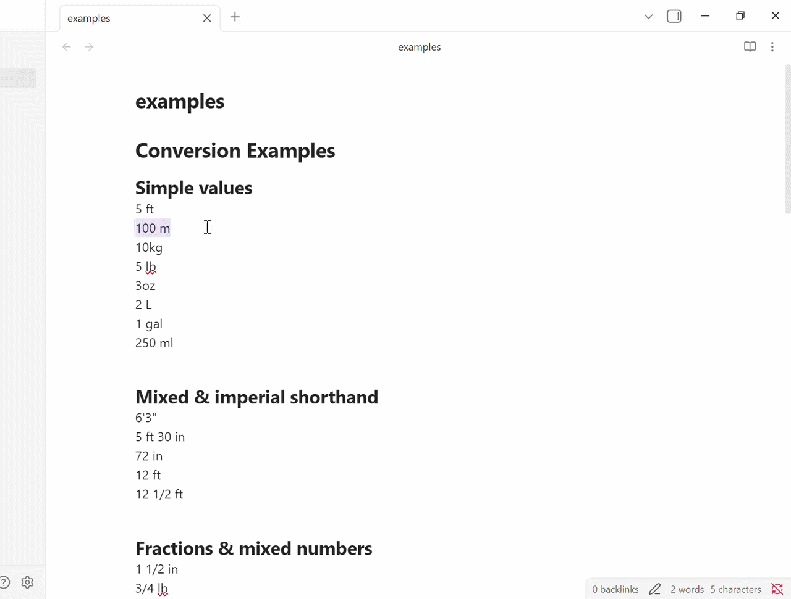
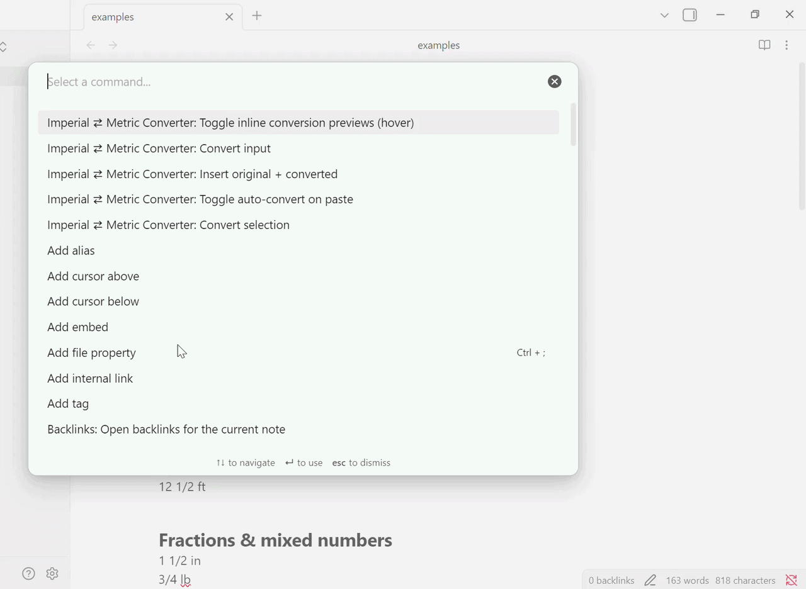
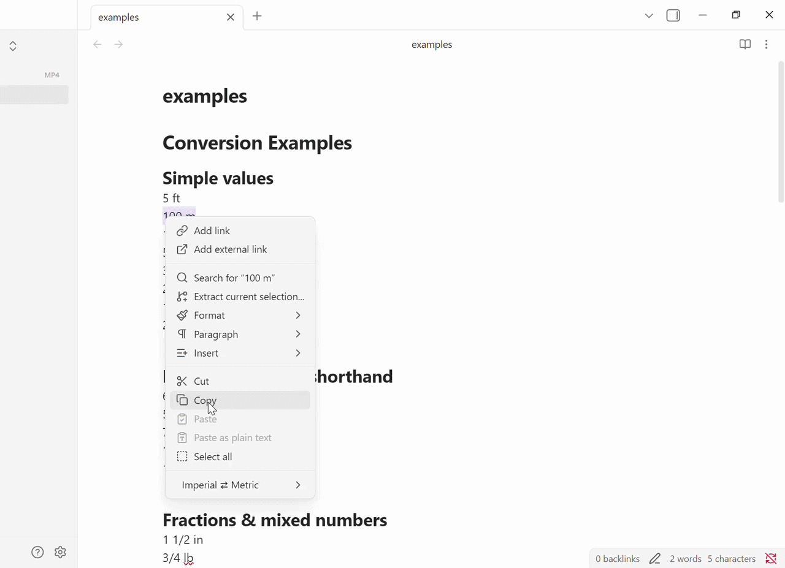
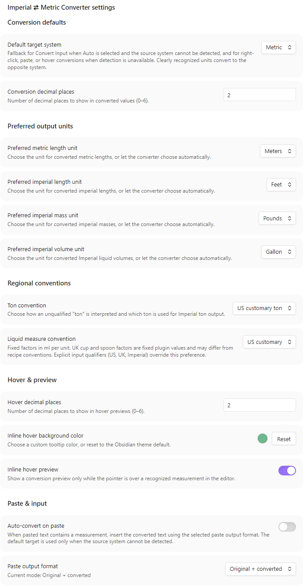

# Imperial to Metric Converter
An [Obsidian](https://obsidian.md) plugin for converting measurements between imperial and metric systems.

## Usage
Select a measurement and run **Convert selection** from the command palette or editor context menu. The plugin recognizes common abbreviations, spelled-out units, mixed measurements, ranges, fractions, temperatures, and multiple values in text. It preserves surrounding text when converting.

You can also enter a measurement with **Convert input (Auto/Metric/Imperial)**, preview conversions on hover, or optionally convert measurements as you paste. Auto conversion targets the opposite system when it can identify the source; otherwise, it uses your default target setting.

### Examples
- Convert a single value: `12 ft` → `3.66 m`
- Convert mixed measurements: `5 ft 3 in` → `1.60 m`
- Convert a range: `10-15 ft` → `3.05 m-4.57 m`
- Keep both values: `12 ft` → `12 ft (3.66 m)`
- Convert multiple measurements in context: `The board is 5 ft long and 2 in thick.` → both values are converted in place.

Commands may have default hotkeys, and bindings can be customized or viewed in Obsidian's **Settings → Hotkeys**.

### Hover previews
Enable inline hover previews to see a measurement's conversion without changing the note.

### Auto-convert on paste
Auto-convert is off by default. When enabled, choose whether pasted text keeps both the original and converted values or inserts only the conversion. Change the output format in settings, from the command palette, or from the editor context menu.

## Settings
Settings let you choose the default target system, output units, decimal precision and rounding mode, hover appearance, and US or UK / Imperial liquid measure conventions. Optional custom liquid factors are available for unqualified measures; explicit `(US)`, `(UK)`, or `(Imperial)` qualifiers use standard factors.

## Supported measurements
Length, mass, volume, and temperature units are supported, including common abbreviations and spelled-out aliases in English, Spanish, French, and German. Alias coverage is not exhaustive, and ambiguous or complex text may not always be parsed as intended.

UK cup and spoon defaults are fixed plugin values, but you can override them with custom liquid-measure factors. The defaults may differ from recipe conventions.

## Known limitations
Parsing uses heuristics, so complex or ambiguous text may not convert as expected. Localized aliases are not exhaustive, and invalid fractions such as `1/0 in` are ignored.

## What's New
### 0.1.3
- Added localized unit aliases, negative measurements, and support for hyphenated values.
- Added rounding modes and configurable custom ml-per-unit factors, reset controls, and fallback to US or UK / Imperial defaults. Explicit qualifiers retain standard factors.
- Added a command-palette and editor-menu toggle for paste output format, with a default hotkey, plus live paste status in settings.
- Improved hover previews.

## Installation
1. In Obsidian, open **Settings → Community plugins** and turn off Safe Mode if needed.
2. Select **Browse**, find **Imperial to Metric Converter**, then install and enable it.
3. Configure the plugin under its settings.

## To Do
Suggestions for future features or updates are welcome. Please open an issue in the [GitHub repository](https://github.com/p0shkar/ImperialToMetric-for-Obsidian).
- Update README gifs to align with updated changes.

## Contributing
Suggestions and contributions are welcome. Please open an issue or pull request in the [GitHub repository](https://github.com/p0shkar/ImperialToMetric-for-Obsidian).

### Caveat
I'm not a developer, so this plugin is largely vibe-coded. It is functional, but may still contain rough edges, assumptions, and areas that need cleanup or hardening.

### License
This project is licensed under the MIT License - see the [LICENSE](./LICENSE) file for details.

## Contact and support
Created by [Oskar Norén](https://github.com/p0shkar). If you find the plugin useful, you can [buy me a coffee](https://www.buymeacoffee.com/p0shkar).

